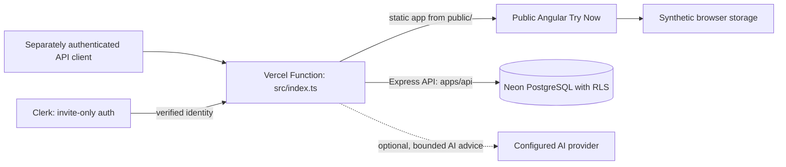

# Cadence for Coding in Color

Cadence is an open-source donor and funder relationship platform built for Coding in Color at the ASU Fall Hackathon 2026. It brings donor and gift records, human-reviewed follow-ups, import review, and funder reporting into one workspace. Open [cadence-cic.vercel.app](https://cadence-cic.vercel.app), choose **Try Now**, and explore fictional records stored in your browser. No account is required. Admins see the organization; board personas see their assigned records. Switching people returns to Overview; edits and persona selection survive refresh.

The public frontend never loads Clerk, `config.json` or protected API routes, even with `?demo=0`. Browser data does not prove server persistence, authorization or delivery. The separate backend retains Clerk verification, admin MFA and database row-level security. Source implementation, recorded tests and deployment acceptance are distinct; see [requirements](docs/REQUIREMENTS.md) and [the live acceptance gate](docs/P0-LIVE-PLAN.md). No new deployment check was performed for this documentation repair.

| | |
|---|---|
| **Nonprofit** | [Coding in Color](https://www.ohack.dev/nonprofit/YIXYdYCoxIZC08uQ5DL3) |
| **Problem** | [Donor & Funder Relationship Platform (CIC Problem 2)](https://www.ohack.dev/project/e26932c0df1b11f189a8dead68f07eb5) |
| **Team** | [avengers](https://www.ohack.dev/hack/fall-2026/team/959f5c24e05811f1adacdeadb145c312) · [Team Dashboard](https://www.ohack.dev/hack/fall-2026/manageteam) |
| **Slack** | [#avengers](https://opportunity-hack.slack.com/app_redirect?channel=avengers) · [#npo-coding-in-color](https://opportunity-hack.slack.com/app_redirect?channel=npo-coding-in-color) · [#ask-a-mentor](https://opportunity-hack.slack.com/archives/C01E5CGDQ74) |

> This is the team's one repository. Judges, the Team Dashboard and the nonprofit use this repo. Do not create a second project repo.

## Final day and submission

Hackathon schedule for Sun Nov 15: recording starts at **12:00 PM MST**; hacking ends at **2:00 PM MST**. Submission is through the [Team Dashboard](https://www.ohack.dev/hack/fall-2026/manageteam).

- [ ] Push code to this repository in small pull requests.
- [ ] Add the project story to the dashboard: problem, who it helps, what is built, and what's next.
- [ ] Add a demo video of four minutes or less. Show the product, not slides. Link it on the dashboard.
- [ ] Submit through the dashboard.
- [ ] Keep this README current with setup, deployment, team and live/demo links.
- Optional: [DevPost entry](https://opportunity-hack-2026-arizona.devpost.com/). The dashboard is the submission of record.

## Team

- [Ash](https://github.com/ashworks1706) — UI and shared visual components (Person 3)
- [Ibrahim Ali](https://github.com/ibrahim-alii) — core backend (Person 2)
- [Aayan Mapara](https://github.com/amapara27) — data ingestion and reconciliation (Person 1)
- [Soumya Mejari](https://github.com/smejari1) — outreach and follow-ups (Person 4)
- [Nathan Narrik](https://github.com/nathannarik) — reporting, deployment and integration QA (Person 5)

## What it does

- **Donors and gifts:** scoped donor records, ownership, gift ledger, contact history and follow-up queue. Currency totals stay separate.
- **Import:** CSV and XLSX upload, mapping, validation, explicit review of donor/gift matches and atomic commit. Missing dates or financial facts are never guessed. Re-imports are fingerprinted.
- **Follow-ups:** tasks, quarterly touches and message drafts. People approve exact content and send through their own email or phone. Nothing sends automatically.
- **Reporting:** retention views and audited funder packets. A read-only aggregate API suppresses small groups.
- **Public workspace:** one-click Try Now, actual admin/board persona scope, potential donors, Ask your data and Bar/Line/Area donation charts.
- **Separate backend:** Clerk-verified sessions, admin MFA and organization/member-scoped database access; this is not the public frontend login flow.

These describe implemented code, not a claim that each signed-in flow has passed deployed acceptance. See [requirements and acceptance evidence](docs/REQUIREMENTS.md) and [the live gate](docs/P0-LIVE-PLAN.md).

## Architecture



The app and API share one Vercel project and origin. `src/index.ts` serves the built Angular app from `public/` and routes API requests to Express. Public startup uses local fixtures and does not connect to that API. Separately authenticated API requests require Clerk verification; PostgreSQL row-level security (RLS) enforces organization and donor visibility. Optional backend AI calls are not required for Try Now.

**Key decisions**

- One same-origin service keeps browser/API routing and CORS configuration simple.
- RLS plus a restricted runtime database role limits data access; the API does not connect as the migration owner.
- Only a migration owner runs schema changes and trusted organization provisioning.
- Public startup selects browser data before config/auth access; `config.json` cannot enable live frontend access. Retained live-client source is not an exposed login option.
- People review every outbound message; there is no automatic send.
- Money uses integer cents; ambiguous dates and missing facts are not guessed.
- The aggregate read API returns no donor identities and suppresses groups smaller than three.

Architecture and delivery decisions are recorded in [`docs/`](docs/), GitHub issues and pull requests. See [deployment](docs/DEPLOY.md), [requirements](docs/REQUIREMENTS.md), [demo guidance](docs/DEMO.md), and [P0 acceptance plan](docs/P0-LIVE-PLAN.md).

| Path | Contents |
|---|---|
| `apps/api/` | Express API, auth and server-side workflows |
| `apps/web/` | Angular application |
| `packages/*` | Shared contracts, import, outreach and reporting logic |
| `db/` | PostgreSQL migrations and trusted database tools |
| `deploy/` | Vercel build/config checks and smoke test |
| `src/` | Vercel function entry point and web serving |
| `tools/` | Local import and maintenance tools |
| `tests/` | Integration and feature tests |
| `data/` | Synthetic import fixtures |
| `docs/` | Deployment, demo, requirements and audit notes |

## Quick start

### Requirements

- Node.js **24.15 or newer within 24.x** (`package.json` requires `>=24.15.0 <25`).
- PostgreSQL 16 or newer for a full local API/database stack. The web demo alone needs no database or Clerk account.

### Clone and install

```bash
git clone https://github.com/2026-Arizona-Opportunity-Hack/avengers-CodinginColor.git
cd avengers-CodinginColor
npm ci
npm ci --prefix apps/web
```

### Run the browser demo only

No `.env`, database, Clerk account or `config.json` is needed. From the repository root:

```bash
npm start --prefix apps/web
```

Open the URL printed by Angular, normally `http://localhost:4200`. The app uses synthetic data in the browser. It does not call the API or prove server persistence or authorization.

### Run the protected backend separately (optional)

Create a local `.env` from the example and supply your own values. Never commit `.env`:

```bash
cp .env.example .env
```

Set up PostgreSQL 16+, configure a privileged `MIGRATION_DATABASE_URL` and a separate restricted runtime `DATABASE_URL`, then apply migrations and provision the organization/members. The roster JSON must be stored outside the repository and contain Clerk user IDs and roles. See [`db/README.md`](db/README.md) and [`docs/DEPLOY.md`](docs/DEPLOY.md) for role and Clerk setup.

```bash
node --env-file-if-exists=.env db/migrate.ts
node --env-file-if-exists=.env db/provision.ts /path/to/roster.json
```

For fictional local demo records only, after provisioning an active admin and board member:

```bash
node --env-file-if-exists=.env db/seed-demo.ts --yes-demo-data
```

The seed refuses an organization with real/non-demo donors. These are operator actions for an authorized local database, not prerequisites for Try Now. Start the API from the repository root:

```bash
npm run start:api
```

The API listens on port 3000 by default. Use separately authenticated API clients and the contracts in [`apps/api/README.md`](apps/api/README.md) for backend development; starting it does not connect the public frontend. The Angular server retains its `/api` proxy, but public startup makes no API requests. Adding a public config file cannot enable a live sign-in screen. Keep Clerk secrets, session credentials and database URLs out of frontend configuration.

## Environment variables

The API validates required settings at startup. Deployment validation checks variable names without printing values. Set local values in `.env`; set deployment values in Vercel project environment settings. Never put secrets in the web build or commit them.

| Variable | Required? | Used by | Where set | Secret? | Purpose / validation |
|---|---|---|---|---|---|
| `DATABASE_URL` | Yes for live API | `apps/api/env.ts`, `src/index.ts`, `apps/api/server.ts` | Local `.env`; Vercel runtime | Yes | PostgreSQL URL for restricted runtime login. Use pooled Neon URL in deployment; never use migration owner. |
| `CIC_ORG_ID` | Yes for API and DB tools | `apps/api/env.ts`; `db/provision.ts`, `db/seed-demo.ts`, `db/api-key.ts` | Local `.env`; Vercel runtime | No | Deployment organization UUID. Must be a UUID. |
| `CLERK_SECRET_KEY` | Yes for live API | `apps/api/env.ts`, `apps/api/auth.ts` | Local `.env`; Vercel runtime | Yes | Server-only Clerk secret. Must start `sk_test_` or `sk_live_`. |
| `CLERK_JWT_ISSUER` | Yes for live API | `apps/api/env.ts`, `apps/api/auth.ts` | Local `.env`; Vercel runtime | No | Clerk issuer URL; must use HTTPS. |
| `APP_ORIGIN` | Yes for live API | `apps/api/env.ts`, `apps/api/app.ts`, `deploy/check-env.ts` | Local `.env`; Vercel runtime | No | Exact allowed origin, without a path or trailing slash. HTTPS in Vercel; local HTTP allowed only for localhost/127.0.0.1. |
| `PORT` | No; defaults to `3000` | `apps/api/env.ts`, `apps/api/server.ts` | Local `.env` or host runtime | No | API listen port, integer 1–65535. Vercel function does not call `listen()`. |
| `MIGRATION_DATABASE_URL` | Required for migration/provision/seed tools | `db/migrate.ts`, `db/provision.ts`, `db/seed-demo.ts`, `db/api-key.ts` | Local `.env` only; never Vercel | Yes | Privileged direct PostgreSQL URL for operator tools. Do not use as API runtime credential. |
| `CLERK_PUBLISHABLE_KEY` | Required by default deployment builder | `deploy/vercel-build.ts`, `deploy/check-env.ts` | Local build environment or Vercel build settings | No; public | Public Clerk key written into generated `public/config.json`. Must match test/live mode of secret key. |
| `NEXT_PUBLIC_CLERK_PUBLISHABLE_KEY` | Alias for above | `deploy/vercel-build.ts` | Build environment | No; public | Fallback alias if `CLERK_PUBLISHABLE_KEY` is unset. |
| `CIC_WEB_DEMO_MODE` | Optional | `deploy/check-env.ts`, `deploy/vercel-build.ts` | Build environment, usually Vercel | No | Set exactly to `1` to omit generated config and skip build-time validation. Runtime API validation/authentication still applies; this flag is not needed for public Try Now. |
| `OPENAI_BASE_URL` | Optional | `apps/api/ai.ts`, `tools/benchmark-search.ts` | Local `.env`; Vercel runtime if enabling AI | No | Optional AI-compatible API base URL; defaults to `https://api.openai.com/v1`. |
| `OPENAI_API_KEY` | Optional | `apps/api/ai.ts`, `tools/benchmark-search.ts` | Local `.env`; Vercel runtime if enabling AI | Yes | Optional model-provider credential. Missing key uses deterministic fallback where supported. |
| `OPENAI_MODEL` | Optional | `apps/api/ai.ts`, `tools/benchmark-search.ts` | Local `.env`; Vercel runtime if enabling AI | No | Optional configured model name. |
| `TYPESAFE_API_KEY` | Optional | `tools/import-suggest.ts` via `apps/api/import-suggestions.ts` | Local `.env`; Vercel runtime if enabling suggestions | Yes | Optional TypeSafe Jev/System One credential for unknown column-header suggestions. Only the header is sent; suggestions require human approval. |
| `JEV_API_KEY` | Legacy optional alias | `tools/import-suggest.ts` | Local `.env`; Vercel runtime if enabling suggestions | Yes | Fallback when `TYPESAFE_API_KEY` is not set. |
| `VERCEL` | Set by Vercel | `deploy/check-env.ts` | Vercel platform | No | When `1`, requires `APP_ORIGIN` to start with HTTPS. Do not set manually for local work. |
| `CIC_NATIVE_TEST_URL` | Optional; native DB test only | `tests/import-native.test.ts` | Test environment/CI only | Yes | Enables the optional native PostgreSQL concurrency test. Use only the empty disposable loopback database described in `apps/api/README.md`; never point it at live data. |
| `CORE_TEST_DATABASE_URL` | Optional; assignment PostgreSQL test | `tests/assignment-postgres.test.mjs`, `.github/workflows/ci.yml` | Test environment/CI only | Yes | Disposable PostgreSQL database for the assignment integration test. |
| `API_BASE_URL` | Not used by code | `.env.example` only | Not needed | No | Example-file setting only. Retained live-client code understands config; public startup ignores it. |

On Vercel, `deploy/check-env.ts` also validates the API variables during the build, so a missing or malformed value fails the deploy before it goes live.

The default builder still writes public `apiBase` and `clerkPublishableKey` into `public/config.json` for retained integration code and the smoke contract. Public startup does not request it; its presence cannot enable live sign-in. Never put secrets in it. `CIC_WEB_DEMO_MODE=1` omits the file, but `src/index.ts` still validates backend settings at runtime.

## Deploy

The Vercel project must use the **repository root**. `vercel.json` selects the Express framework, installs root and web dependencies, validates settings, builds Angular, then runs `deploy/vercel-build.ts`. `src/index.ts` serves `public/` and the API from one function. Do not configure Vercel to use `apps/web` as its root; that can deploy a static demo without the API.

Production uses Neon PostgreSQL with two logins: a privileged migration owner and a restricted pooled runtime login. Apply migrations, provision the organization/members, and optionally seed fictional demo data from a person's machine with `MIGRATION_DATABASE_URL`; never run privileged migrations in the Vercel build. Configure Clerk for invite-only access and require admin MFA. Then deploy and run the unauthenticated smoke check:

```bash
node deploy/smoke.ts https://cadence-cic.vercel.app
```

This checks health, config, page/deep-link routing, API auth/origin behavior and API 404 handling. It does not prove signed-in flows. Follow [`docs/DEPLOY.md`](docs/DEPLOY.md) for full setup, database-role safety, and manual signed-in acceptance. See [`docs/DEMO.md`](docs/DEMO.md) for what the demo can and cannot claim.

## Tests

From the repository root:

```bash
npm run typecheck
npm run test:contracts
npm run test:api
node --test tests/*.test.ts tests/*.test.mjs packages/reporting/*.test.ts packages/outreach/*.test.ts
```

The CI backend command also runs migration, import and related package tests with concurrency 2:

```bash
node --test --test-concurrency=2 apps/api/*.test.ts tests/*.test.ts tests/*.test.mjs packages/contracts/*.test.ts packages/imports/*.test.ts packages/outreach/*.test.ts packages/reporting/*.test.ts
```

CI installs root dependencies, runs typecheck and backend tests, then installs `apps/web` dependencies and runs:

```bash
npm run test --prefix apps/web -- --watch=false
npm run build --prefix apps/web
```

## Import pipeline (Data)

Local CSV preflight validates UTF-8 CSV up to 5 MiB, preserves raw cells and record numbers, and prints counts/issues rather than donor contact details. It does not write to the database. Example:

```bash
node tools/import-preview.ts zeffy data/zeffy_export.csv
node tools/import-preview.ts az_gives apps/web/public/samples/az_gives_export.csv --date-format MM/DD/YYYY --utc-offset -07:00
node tools/import-suggest.ts zeffy data/zeffy_export.csv
```

The supported source labels (`spreadsheet`, `zeffy`, `benevity`, `az_gives`, `united_way`) are provenance labels, not verified provider adapters. Ambiguous dates require explicit format and UTC offset; money is converted to exact integer cents. Missing currency, dates, status/refund facts or uncertain matches stay in human review. Jev suggestions are optional, send only unknown headers, and are never applied without reviewer approval.

Reconciliation separates donor identity from gift identity. A donor link needs a unique corroborated email; gift replay checks source/external ID and provenance independently. Same-source no-ID matches from earlier files require review. Review plans do not authorize or persist writes: the server rebuilds them against fresh scoped facts and commits reviewed changes atomically. See [API import flow](apps/api/README.md), [database notes](db/README.md), and the [local import/review tools](tools/).

Saved review fingerprints exact file bytes and binds decisions to a plan hash; that hash detects stale edits, not forgery. Gift persistence accepts reviewed inserts and financial corrections inside the caller's transaction, refuses identity rewrites, uses RLS and records audit events. The server must authorize the reviewer, rebuild against fresh facts and apply atomically.

## Security, privacy and accessibility

- Never commit `.env`, credentials, donor records or real donor data in demo materials. Use synthetic records.
- The API uses a restricted database role and RLS. Clerk identity, active membership, organization and donor scope are checked server-side. Admin actions require verified MFA.
- Import suggestions send a header only, not donor rows or sample values. Optional model adapters receive bounded/structured inputs; they are not required for core operation.
- Messages require human approval and manual sending. Aggregate reporting exposes no donor identities and suppresses small groups.
- Read [mobile accessibility audit](docs/audits/mobile-accessibility-2026-11-15.md) and [requirements/audit evidence](docs/REQUIREMENTS.md). Audit scores are snapshots, not a site-wide conformance claim.

## Demo video

Demo video: not yet supplied. Add the final link here and on the Team Dashboard before submission.

See the [demo script](docs/DEMO.md). Narrate once that Try Now uses fictional browser data; no on-screen synthetic badge is required. A 7/7 smoke result only proves public routes/config behavior; include signed-in server proofs only after rehearsing them on the deployed site.

## Agent message board

Team and agents coordinate on the pinned [GitHub issue #3](https://github.com/2026-Arizona-Opportunity-Hack/avengers-CodinginColor/issues/3). The board is not an agent launcher. See the [board guide](https://marvelous-relative-5de.notion.site/hack) and `tools/board.py` for commands.

## After the hackathon

The team should finish with Coding in Color, transfer service ownership, confirm nonprofit acceptance, and keep this repository and its documentation current. See the [Definition of Done](https://www.ohack.dev/about/completion) and [`docs/DEPLOY.md`](docs/DEPLOY.md) for handoff and operations notes.

## License

MIT. See [`LICENSE`](LICENSE).
