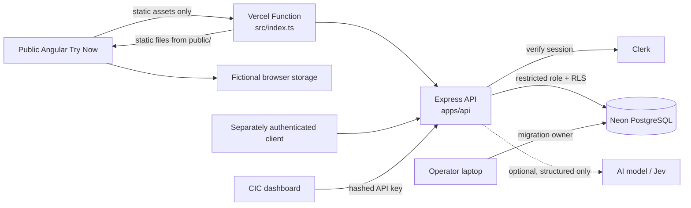
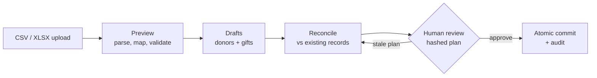
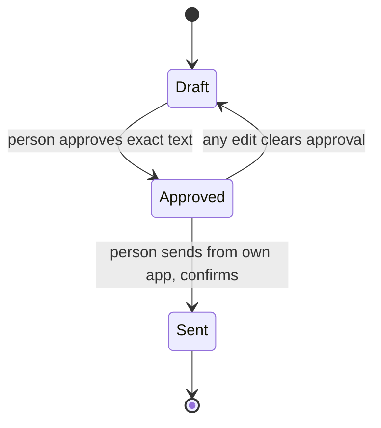

# Architecture decisions

Why Cadence is built the way it is, what each choice cost, and how it shaped the project. Setup and environment variables are in the [README](../README.md); hosting steps are in [DEPLOY.md](./DEPLOY.md).

## System overview



## 1. One service for the app and the API

**Choice:** One Vercel Function (`src/index.ts`) serves both the built Angular app and the Express API from the same origin. Public startup always uses fictional browser data; it never reads `config.json`, starts Clerk or connects to the protected API. The deployment builder still emits public config for retained integration code and the smoke contract.

**Why:** No CORS setup, one deploy, one URL for CIC to remember, and it fits the plan's $20/month hosting budget.

**Impact:** Serverless bundling caused most of our deploy failures. Vercel kept `.ts` import paths (#212), missed a dynamically imported parser (#213) and bundled only part of `public/` (#214, #220). The public smoke check went from 2/7 to 0/7, then 7/7. Each function keeps a small database pool (3 connections) because instances are short-lived. Vercel Hobby is non-commercial, so CIC's ongoing use probably needs Vercel Pro.

## 2. TypeScript everywhere, run directly by Node

**Choice:** The backend, scripts and tests are TypeScript, run directly by Node 24 with no build step. Shared Zod schemas in `packages/contracts` define donors, gifts and money once for both sides.

**Why:** One language across the API, the web app, the database tools and the tests. Any teammate could read any part, and validation rules couldn't drift between the browser and the server.

**Impact:** Fast iteration and no compiled output to keep in sync. The Node version is pinned (`>=24.15 <25`), and Vercel needed `rewriteRelativeImportExtensions` to run the same files.

## 3. Security enforced by the database

**Choice:** Every table has PostgreSQL row-level security (RLS). The API logs in as a restricted login and, for each request, switches to the `cic_runtime` role (`NOBYPASSRLS`) and stamps the organization and user on the transaction (`apps/api/db.ts`). Schema changes, provisioning and seeding run only from a person's machine with a separate migration owner login.

```mermaid
sequenceDiagram
  participant B as Browser
  participant A as API
  participant P as PostgreSQL
  B->>A: request + Clerk session token
  A->>A: verify token, membership, admin MFA
  A->>P: BEGIN; SET LOCAL ROLE cic_runtime
  A->>P: set_config(app.org_id, app.user_id)
  A->>P: query
  P-->>A: only rows this member may see
  A->>P: write + audit event, COMMIT
```

**Why:** Board members must never see each other's donors. If a route forgets a check, the database still filters the rows, so a pasted donor link from another member returns "not found".

**Impact:** The strongest security guarantee we have, but more setup. Roles created in the Neon console join `neon_superuser` and can bypass RLS, so the runtime login must be created with SQL. That edge case got its own CI rehearsal on PostgreSQL 17. Operators, not the deploy, run migrations.

## 4. Invite-only sign-in with admin MFA checked on the server

**Choice:** The separate protected API verifies Clerk sessions and refuses an admin session without a verified second factor (`apps/api/auth.ts`). Public Try Now has no Clerk login, enrollment or live-mode toggle; persona selection is a browser demonstration, not authentication.

**Why:** Donor contact details are sensitive, and the people who can export them must use two-step verification.

**Impact:** Real security, but setup friction for judges and new users. We added **Try Now**, a synthetic browser workspace that needs no account. A production instance needs a domain CIC controls.

## 5. Imports are reviewed before anything is saved

**Choice:** Backend imports run in stages. Nothing is written until an admin approves, and the commit is all-or-nothing. The pipeline/hash/audit diagram below describes that protected backend. Public imports instead review and save browser-local records; their documented US/Phoenix date interpretation and replay checks do not prove server persistence.



- Money is parsed from text into integer cents, never floats. Dates without a clear format or time zone must be confirmed by a person.
- A donor links to an existing record only on a unique matching email. Everything else goes to review.
- A gift is identified by its transaction ID, or by its file and row when there is none. The exact file is fingerprinted, so importing it again adds no duplicate gifts.
- The review plan is hashed, so decisions made on an outdated plan are rejected.

**Why:** Financial records feed funder reports. A silently wrong merge or a guessed date is worse than an extra click.

**Impact:** More review steps for the admin, especially with the sample exports, which lack dates and currencies. In exchange, re-imports are safe and nothing is guessed. Real provider formats still need CIC's de-identified samples.

## 6. People send every message

**Choice:** Cadence drafts from templates. Backend approval binds exact content with a hash; browser Try Now keeps local approval state. Editing or explicitly regenerating an unsent draft clears approval. Compose links open the person's own email or SMS app (`mailto:` / `sms:`); only a person's confirmation can log a manual send. Neither local history nor opening a compose link proves delivery.



**Why:** The plan rules out autonomous sending, and messages from a board member's own address read as personal.

**Impact:** No email provider costs, keys or deliverability setup. The tradeoff: Cadence can't confirm delivery, so the person confirms the send.

## 7. AI is optional and kept small

**Choice:** Public Ask your data uses supported local filters, without model/API requests. Retained backend adapters can propose bounded filter choices or select supplied structured facts; Jev suggests unknown column mappings for human review. These optional integrations are separate from the public walkthrough and do not authorize model writes or autonomous sending.

**Why:** Donor privacy, predictable wording, and no paid AI dependency for core features.

**Impact:** Less free-form writing, but the app works with no AI configured. Benchmarking found that valid model answers were rejected because of JSON key order. That was fixed in #222 (issue #221).

## 8. Public Try Now with retained backend integration source

**Choice:** Public startup selects browser-local data before config/auth access. `config.json` and `?demo=0` cannot enable live login. Actual admin and board personas use their own role scope; changing person returns to Overview. Retained live-client/backend source remains protected and is not an exposed public mode.

**Why:** Designers and judges could use the full UI before the backend was deployed, without risk to real data.

**Impact:** The public walkthrough needs no account or database and cannot change production records. Two code paths remain in the source, but public UI evidence proves only browser behavior. Backend acceptance requires separate authenticated tests; no current deployed result is claimed by this document.

## 9. Aggregate-only read API for CIC's dashboard

**Choice:** CIC's dashboard reads totals by period, program and board member with an API key that is stored only as a hash. Groups with fewer than three donors are hidden, and requests are rate-limited.

**Why:** CIC wanted its own dashboard to read Cadence without exposing donor identities.

**Impact:** Safe to share, but the dashboard can't drill down to individual donors. That stays inside the signed-in app.

## 10. Tests run the real migrations

**Choice:** Database-facing tests apply the real SQL migrations to an in-memory PostgreSQL (PGlite), so RLS, roles and constraints are exercised. CI runs the typecheck, the backend tests, the web tests and build, and a PostgreSQL 17 managed-role rehearsal.

**Why:** Most of the security lives in SQL, so testing against mocks would miss it.

**Impact:** No credentials needed to run the suite, and regressions in access rules show up in PRs. PGlite isn't identical to Neon, which is why the role rehearsal runs separately.
