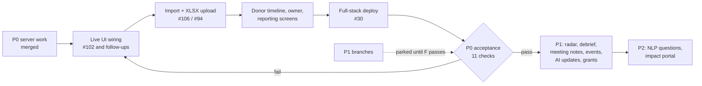

# P0 live gate and P1/P2 plan

Verified against `origin/main` at `4db4643` plus open PR #102 (`de4792d`), 2026-11-15 10:35 UTC.

## Priority rule

**No P1 work starts until every P0 feature is live and verified.**

P1 proposals are recorded here so nobody loses them, not as a queue to start. If a P1 branch already exists, park it until the P0 gate below passes.

"Live" means the signed-in web app calls the API, persists the change, and reloads it from the server. Demo-mode behaviour does not count.

## P0 status

Use [board #3](https://github.com/2026-Arizona-Opportunity-Hack/avengers-CodinginColor/issues/3), task issues and merged PRs for current implementation status. A passing local test or merged PR is not deployed acceptance.

Track the remaining live workflows in #106 (imports), #111 (history), #113 (Clerk/MFA), #115 (manual entry/ownership), #116 (reporting) and #30 (deployment). Retention's prior live periods are not wired; its demo-history chart is restricted to demo mode. Verify current behavior against the acceptance gate below instead of assuming these issue references are still open.

## P0 acceptance gate

All of these must pass on the deployed app before P1 starts:

1. Import each of the three source files, review, commit, reload, reimport the same file: zero duplicate gifts.
2. Ambiguous donors go to human review, never auto-merged.
3. Donor timeline shows gifts and communications together.
4. New donors get the board member with the fewest donors; reassignment persists.
5. A next step and a quarterly touch can be created, completed and seen after reload.
6. Retention shows year-over-year new/increased/decreased/lapsed from server data.
7. A thank-you is drafted, approved by a person, and its send history persists.
8. Funder CSV export comes from the audited server endpoint.
9. Read API returns period/program/owner aggregates with a valid key and rejects a bad one.
10. `node deploy/smoke.ts <url>` passes 7/7 and a signed-in journey passes.
11. Signing out clears protected views and cached reports.

## Work split until the gate passes

The explicit human-directed takeover assigns remaining P0 implementation and integration to Ibrahim's session. Inactivity alone never transfers ownership. Nathan is available for independent review; Aayan handles coordination and acceptance review. Agree file boundaries before concurrent implementation.

The human subsequently authorized independent subagent reviews within Ibrahim's session and merging passing PRs without waiting for unavailable teammates. Record exact reviewed heads and executed tests. Keep implementation, independent review and deployed acceptance evidence distinct.

## Reference documents

Read these before changing P0 code:

- [This plan](./P0-LIVE-PLAN.md), including the P0 table and the 11-check acceptance gate.
- [README](../README.md): run commands, feature claims, import contract summary and test commands.
- [Deployment guide](./DEPLOY.md): full-stack Vercel settings and smoke check.
- [Demo script](./DEMO.md): what the demo may and may not claim.
- [AGENTS.md](../AGENTS.md): repository working agreements.
- Issue #19 comment `6890332974`: the published import API contract.
- [#94](https://github.com/2026-Arizona-Opportunity-Hack/avengers-CodinginColor/issues/94): XLSX upload transport.
- [#30](https://github.com/2026-Arizona-Opportunity-Hack/avengers-CodinginColor/issues/30): full-stack deployment.
- [Implementation requirements](../CIC_Donor_Platform_Implementation_Plan.pdf), tracked in this repository.

Rules:

- One owner per file. Do not edit another owner's branch without an explicit handoff.
- Demo data must never be presented as a server-backed result.
- Failed writes must surface an error, never a success message.
- Keep session-loss guards; late responses must not restore a signed-out session.

## P1 after the P0 gate

Owners are provisional and require human agreement. Agent inactivity does not reassign work. Calendar and grant integrations remain deferred beyond the PDF P1 scope unless humans explicitly reprioritize them.

| Feature | Intended slice | Provisional owner |
|---|---|---|
| Lapsed-donor radar | Use the server retention `lapsed` segment to create a reviewed nudge draft and a follow-up date | Ibrahim backend, Ash UI |
| Debrief to action | Voice or text note becomes a structured contact record, a next step with a date, and a drafted follow-up | Nathan |
| Meeting notes in | Accept Gemini or Google Meet notes through the same debrief pipeline | Nathan |
| Events-aware next steps | Read the CIC Google Calendar and turn "invite to the next event" into a dated action | Ash with Ibrahim |
| AI-drafted donor updates | Draft from gift history plus funded outcomes; human approves before send | Nathan |
| Grant deadline tracker | Track deadlines and assemble the funder packet as the date approaches | Nathan |

## P2 provisional

- Natural-language donor questions: chatbot over authorized, allowlisted filters.
- Donor impact portal: verified donor account sees the gifts and outcomes their money funded.
- Likelihood-to-give scoring is not in scope unless the humans add it.

P2 shape is intentionally undecided.

## Model boundary

- **Jev / System One is for data processing only**: column mapping, classification and other structured decisions. It is not a writing model.
- **Drafting uses an LLM**: thank-yous, nudges, donor updates, debrief follow-ups and meeting-note summaries. A human approves every outbound message.
- Do not send donor rows or sample values to Jev. The existing suggestion client sends one bounded header as untrusted state.
- No auto-send. The system drafts and reminds; a person sends.

## Sequence

