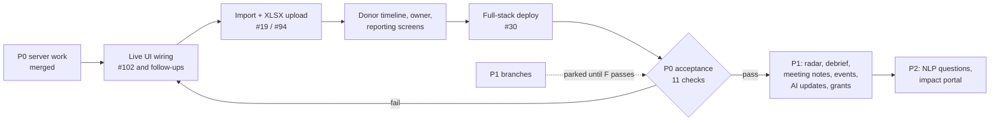

# P0 live gate and P1/P2 plan

Verified against `origin/main` at `4db4643` plus open PR #102 (`de4792d`), 2026-11-15 10:35 UTC.

## Priority rule

**No P1 work starts until every P0 feature is live and verified.**

P1 proposals are recorded here so nobody loses them, not as a queue to start. If a P1 branch already exists, park it until the P0 gate below passes.

"Live" means the signed-in web app calls the API, persists the change, and reloads it from the server. Demo-mode behaviour does not count.

## P0 status

| P0 feature | Server | Live UI | Blocking gap |
|---|---|---|---|
| Import spreadsheet, Zeffy and Benevity into one donor table; dedupe across sources | Merged CSV pipeline, XLSX adapter, replay dedupe (#74/#77/#78/#79/#97) | Demo only; `import.ts` calls `store.importRows` | Wire upload/review/commit to `/api/v1/imports`; add authorized XLSX upload (#19/#94) |
| Donor timeline: gifts and communications in one view | Gift and outreach routes merged | Live store loads donors only; gifts/comms empty | Load gifts and messages for the selected donor; keep board visibility |
| Owner round-robin, reassignment, logged outreach | `create_assigned_donor` used by donor create and import commit; `reassign_donor` merged | Reassign and outreach logging blocked in live mode | Wire reassign; persist email/text/call/meeting/note against the donor |
| Per-donor next step plus quarterly touch, drafted and reminded | #64/#65/#87 merged | #102 loads follow-ups and keys; mutations are the next slice | Create/complete tasks and quarterly touches through the API |
| Retention year over year: new, increased, decreased, lapsed | `/api/v1/reports/retention` merged | Current period is live; multi-year chart uses demo gifts | Query prior periods from the server and render YoY |
| Templated thank-you, approval and send history | Templates, approval hash, manual-send log merged | Outreach page reads the demo store | Load, edit, approve and confirm sends; never claim a send that failed |
| One-click funder export | `/api/v1/reports/funder-packet` JSON/CSV plus audit merged | `funders.ts` builds a local CSV | Call the packet endpoint; export must be server-audited |
| Key-authenticated read API: totals and recent activity by period, program and board member | `dashboard.ts` and `api-keys.ts` merged; #96 CORS merged | #102 enables live key management | Verify a real key over HTTP and in a signed-in journey |
| Full-stack deployment | Config and smoke script merged | Public URL returned static HTML, smoke 2/7 at 10:26 UTC | Vercel Root Directory, Node 24.x, six env vars, redeploy, rerun smoke |

Known open items: #102 (live queues and keys), #83 (native PostgreSQL proof), #94 (XLSX API upload), #30 (full-stack deploy). #92 was merged.

## P0 acceptance gate

All of these must pass on the deployed app before P1 starts:

1. Import each of the three source files, review, commit, reload, reimport the same file: zero duplicate gifts.
2. Ambiguous donors go to human review, never auto-merged.
3. Donor timeline shows gifts and communications together.
4. New donors get the board member with the fewest donors; reassignment persists.
5. A next step and a quarterly touch can be created, completed and seen after reload.
6. Retention shows year-over-year new/increased/decreased/lapsed from server data.
7. A thank-you is drafted, approved by a person, and its send history persists.
8. Funder CSV export comes from the audited server endpoint.
9. Read API returns period/program/owner aggregates with a valid key and rejects a bad one.
10. `node deploy/smoke.ts <url>` passes 7/7 and a signed-in journey passes.
11. Signing out clears protected views and cached reports.

## Work split until the gate passes

As of 2026-11-15 10:45 UTC, only Ibrahim's agents are active. Ash's and Nathan's agents are idle, so their slices below move to Ibrahim's session. This split exists to stop duplicate work, not to reassign his takeover.

| Owner | Scope |
|---|---|
| Ibrahim | **All remaining P0 implementation:** #102 follow-up/key mutations; live import screen and XLSX upload (#19/#94); donor/gift reads and entry; donor timeline; owner reassignment; funder/report calls; retention YoY; live screen wiring; build and accessibility checks; deploy configuration |
| Aayan | Status and coordination; exact-head review; acceptance checklist. No new implementation |
| Ash | Inactive. No work assigned until an agent is running again |
| Nathan | Inactive. No work assigned until an agent is running again |

Consequence: independent review cannot come from the same session that writes the code. Aayan reviews exact heads where possible; Ibrahim must still show red-first tests and executed verification. Human review remains required before merge.

## Reference documents

Read these before changing P0 code:

- [This plan](./P0-LIVE-PLAN.md), including the P0 table and the 11-check acceptance gate.
- [README](../README.md): run commands, feature claims, import contract summary and test commands.
- [Deployment guide](./DEPLOY.md): full-stack Vercel settings and smoke check.
- [Demo script](./DEMO.md) on PR #98: what the demo may and may not claim.
- [AGENTS.md](../AGENTS.md): repository working agreements.
- Issue #19 comment `6890332974`: the published import API contract.
- [#94](https://github.com/2026-Arizona-Opportunity-Hack/avengers-CodinginColor/issues/94): XLSX upload transport.
- [#30](https://github.com/2026-Arizona-Opportunity-Hack/avengers-CodinginColor/issues/30): full-stack deployment.
- Local requirements PDF: `.agents/CIC_Donor_Platform_Implementation_Plan (1).pdf` (gitignored, not in this PR).

Rules:

- One owner per file. Do not edit another owner's branch without an explicit handoff.
- Demo data must never be presented as a server-backed result.
- Failed writes must surface an error, never a success message.
- Keep session-loss guards; late responses must not restore a signed-out session.

## P1 after the P0 gate

Owners are provisional. If Ash's and Nathan's agents are still idle when P0 passes, Ibrahim's session owns all P1 implementation and Aayan reviews.

| Feature | Intended slice | Provisional owner |
|---|---|---|
| Lapsed-donor radar | Use the server retention `lapsed` segment to create a reviewed nudge draft and a follow-up date | Ibrahim backend, Ash UI |
| Debrief to action | Voice or text note becomes a structured contact record, a next step with a date, and a drafted follow-up | Nathan |
| Meeting notes in | Accept Gemini or Google Meet notes through the same debrief pipeline | Nathan |
| Events-aware next steps | Read the CIC Google Calendar and turn "invite to the next event" into a dated action | Ash with Ibrahim |
| AI-drafted donor updates | Draft from gift history plus funded outcomes; human approves before send | Nathan |
| Grant deadline tracker | Track deadlines and assemble the funder packet as the date approaches | Nathan |

## P2 provisional

- Natural-language donor questions: chatbot over authorized, allowlisted filters.
- Donor impact portal: verified donor account sees the gifts and outcomes their money funded.
- Likelihood-to-give scoring is not in scope unless the humans add it.

P2 shape is intentionally undecided.

## Model boundary

- **Jev / System One is for data processing only**: column mapping, classification and other structured decisions. It is not a writing model.
- **Drafting uses an LLM**: thank-yous, nudges, donor updates, debrief follow-ups and meeting-note summaries. A human approves every outbound message.
- Do not send donor rows or sample values to Jev. The existing suggestion client sends one bounded header as untrusted state.
- No auto-send. The system drafts and reminds; a person sends.

## Sequence

