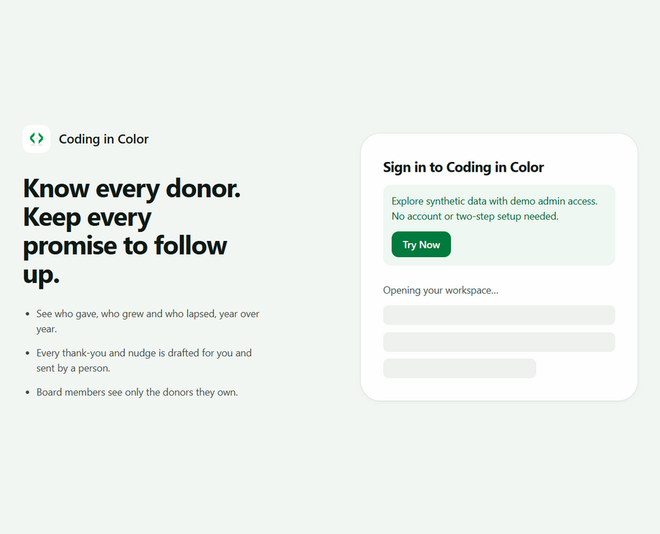
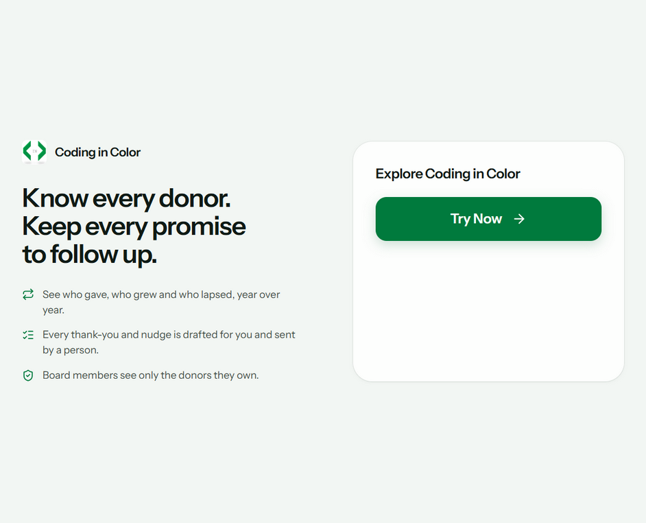

# Try Now entry verification

Issue: #246. Local production build served on `http://127.0.0.1:4311`.

- `/` opens the public entry; Try Now opens `/` as `m-ceo`, admin.
- Initial HTML and Angular keep the CTA in the existing right card; CTA measured 64px high.
- Old setup paragraph, Clerk widget, live-login link and presentation notes are absent.
- Switching from `/outreach` to `m-bell` returns to `/`, shows Your portfolio, and focuses `main`.
- Board navigation omits Import, Funder reports, Read API and Settings.
- Direct board `/settings` redirects to `/`; native reload retains `m-bell` and its board view.
- Profile sign-out returns to entry; reload remains signed out; Try Now re-enters `/` as `m-ceo`.
- Preview serves valid `/config.json` (confirmed separately), but the browser never requests it.
- Orca network inspection: 118 requests across the walkthrough, 0 config/Clerk/API requests, untruncated.
- Orca console inspection: 0 entries, untruncated.
- Angular focused tests: 21/21 pass, including own-record scope, admin guards, epoch, reload/edit persistence and four switch-to-overview cases.
- Full Angular frontend suite: 25 files, 129/129 tests pass.
- Node startup HTML test: 1/1 pass. Production build passes; existing style/CommonJS/compiler warnings remain.

Before image is the original initial HTML startup card; after image is the rendered Angular entry.

Backend authentication, production data, provider accounts and dependencies were not changed. Hosted deployment and prospects integration are separate checks.
